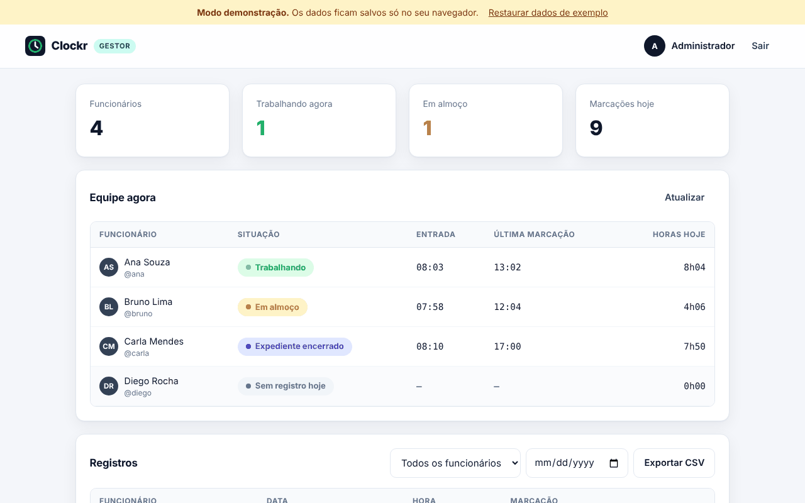
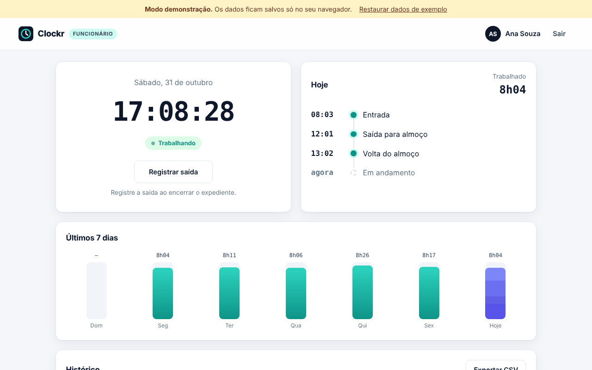
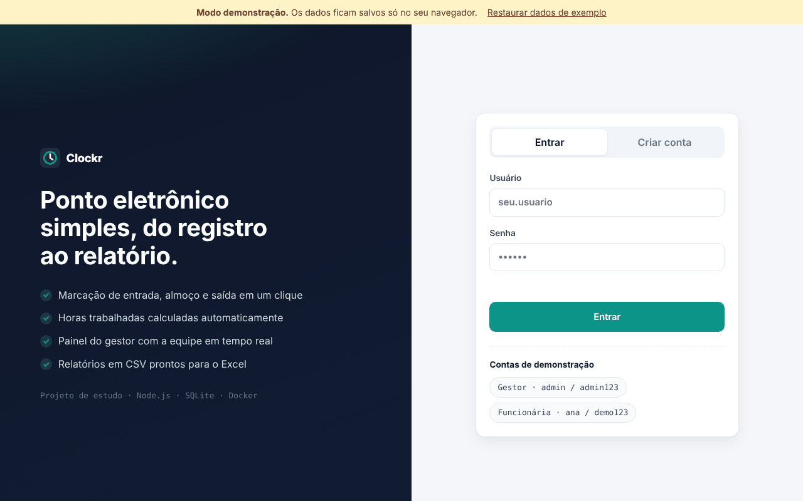

# Clockr — Registro de ponto

[](https://github.com/gabrielmaieski/clockr/actions/workflows/ci.yml)
[](https://gabrielmaieski.github.io/clockr/)

Sistema web de registro de ponto: funcionários marcam entrada, almoço e saída, e o gestor acompanha a equipe em tempo real e exporta relatórios.

**Demonstração online:** [gabrielmaieski.github.io/clockr](https://gabrielmaieski.github.io/clockr/)

> A demonstração roda só no navegador, com dados de exemplo. Para usar com o banco de dados de verdade, suba o servidor com Docker (veja abaixo).



## Funcionalidades

**Funcionário**
- Cadastro e login
- Marcação de entrada, saída para almoço, volta e saída, sempre na ordem certa
- Linha do tempo do dia e horas trabalhadas calculadas automaticamente
- Gráfico dos últimos 7 dias e histórico completo
- Exportação do próprio histórico em CSV (abre direto no Excel)

**Gestor**
- Situação da equipe agora: trabalhando, em almoço, encerrou ou sem registro
- Indicadores do dia e horas trabalhadas de cada pessoa
- Registros com filtro por funcionário e data
- Relatório completo em CSV

| Funcionário | Login |
| --- | --- |
|  |  |

## Arquitetura

```
Navegador (HTML, CSS e JavaScript)
        │
        ├── servidor disponível? ──► API REST (Node.js) ──► SQLite (volume Docker)
        │
        └── sem servidor (GitHub Pages) ──► modo demonstração (IndexedDB no navegador)
```

- **Back-end:** Node.js 22 sem dependências externas, usando os módulos nativos `node:http`, `node:sqlite` e `node:crypto`
- **Banco de dados:** SQLite, com índices e chaves estrangeiras
- **Segurança:** senhas com `scrypt`, tokens de sessão guardados só como hash, CSP e cabeçalhos de segurança, limite de tentativas e proteção contra injeção de fórmula no CSV (detalhes em [Segurança](#segurança))
- **Front-end:** JavaScript puro em módulos, responsivo, com a mesma regra de negócio do servidor (`public/js/core.js`)
- **Infra:** Docker com usuário sem privilégios, volume para o banco e healthcheck
- **CI/CD:** GitHub Actions roda os testes, faz o build e o teste da imagem Docker e publica a demonstração no GitHub Pages

## Como executar

### Com Docker (recomendado)

```bash
git clone https://github.com/gabrielmaieski/clockr.git
cd clockr
ADMIN_PASSWORD='uma-senha-forte-com-12+' docker compose up -d --build
```

Acesse **http://localhost:3000** e entre com o usuário `admin` e a senha definida em `ADMIN_PASSWORD`. O container **não sobe** sem essa variável, nem com senhas fracas ou padrão. Os dados ficam no volume `clockr-data`, então não se perdem ao recriar o container.

### Com Node.js

Requer Node.js 22.13 ou mais recente. Não há nada para instalar.

```bash
npm start   # desenvolvimento: sem ADMIN_PASSWORD, o admin usa a senha admin123
```

### Testes

```bash
npm test
```

## API

| Método | Rota | Descrição |
| --- | --- | --- |
| `GET` | `/api/health` | Status do serviço |
| `POST` | `/api/auth/register` | Cria conta de funcionário |
| `POST` | `/api/auth/login` | Login, retorna o token |
| `POST` | `/api/auth/logout` | Encerra a sessão |
| `GET` | `/api/me` | Usuário atual e situação do dia |
| `GET` | `/api/punches` | Minhas marcações |
| `POST` | `/api/punches` | Registra uma marcação (`entrada`, `saida_almoco`, `volta_almoco`, `saida`) |
| `GET` | `/api/punches/export.csv` | Meu histórico em CSV |
| `GET` | `/api/admin/summary` | Situação da equipe hoje (gestor) |
| `GET` | `/api/admin/punches` | Registros com filtros `user_id` e `date` (gestor) |
| `GET` | `/api/admin/export.csv` | Relatório completo (gestor) |

As rotas protegidas usam o cabeçalho `Authorization: Bearer <token>`.

## Segurança

| Proteção | Como funciona |
| --- | --- |
| Senhas | Hash `scrypt` com salt; comparação em tempo constante |
| Login sem pistas | Usuário inexistente leva o mesmo tempo que senha errada, para não revelar quem está cadastrado |
| Sessões | Token aleatório de 256 bits; o banco guarda só o SHA-256 dele, então um vazamento do banco não dá acesso. Expira em 7 dias e as sessões vencidas são apagadas de hora em hora |
| Força bruta | Limite de falhas de login por IP e por usuário, e de tentativas de cadastro por IP, com `Retry-After` e memória limitada |
| Proxy reverso | `X-Forwarded-For` só é considerado com `TRUST_PROXY=true`, para ninguém burlar o limite inventando um IP |
| XSS e clickjacking | Content-Security-Policy sem `unsafe-inline`, `X-Frame-Options: DENY`, `frame-ancestors 'none'`, `nosniff` e `Referrer-Policy` |
| SQL injection | Todas as consultas usam parâmetros |
| Arquivos | Proteção contra path traversal, inclusive barra codificada e byte nulo |
| CSV | Células que começam com `=`, `+`, `-` ou `@` são neutralizadas, para o Excel não executar fórmulas |
| Configuração | Em produção, o servidor recusa subir sem senha de admin forte |
| Container | Roda com usuário sem privilégios |

A suíte `test/security.test.js` cobre cada item acima, incluindo tentativas de ataque. O CI também confere os cabeçalhos e se o container se recusa a subir sem senha.

**Limitações conhecidas:** o servidor responde em HTTP; em produção, coloque um proxy com HTTPS na frente (ex.: Caddy ou Nginx com Let's Encrypt). O cadastro é aberto a qualquer pessoa, o que serve para a demonstração mas não para uma empresa real. O modo demonstração não tem segurança de verdade: os dados ficam só no navegador de quem usa.

## Variáveis de ambiente

| Variável | Padrão | Descrição |
| --- | --- | --- |
| `ADMIN_PASSWORD` | obrigatória em produção | Senha do usuário `admin`, criado na primeira execução. Com `NODE_ENV=production` (padrão no Docker), precisa ter 12+ caracteres e não pode ser uma senha padrão |
| `TRUST_PROXY` | `false` | Use `true` só atrás de um proxy reverso (Nginx, Caddy, ALB), para identificar o IP real do cliente |
| `PORT` | `3000` | Porta do servidor |
| `DB_FILE` | `./data/clockr.db` | Caminho do banco SQLite |
| `APP_TIMEZONE` | `America/Sao_Paulo` | Fuso usado para definir o "dia" das marcações |

## Estrutura

```
clockr/
├── server/            # API: rotas, autenticação e banco
├── public/            # front-end (também publicado no GitHub Pages)
│   └── js/core.js     # regras de negócio compartilhadas
├── test/              # testes com node:test
├── Dockerfile
├── docker-compose.yml
└── .github/workflows/ # CI e deploy da demonstração
```

## Próximos passos

- [ ] Deploy na AWS (EC2 com Docker) com HTTPS
- [ ] Infraestrutura como código com Terraform
- [ ] Ajuste manual de marcações pelo gestor
- [ ] Banco PostgreSQL como opção para produção

---

Desenvolvido por **Gabriel Maieski Silva** · [LinkedIn](https://www.linkedin.com/in/gabrielmaieski) · Projeto iniciado como trabalho acadêmico e reescrito como projeto full stack.
